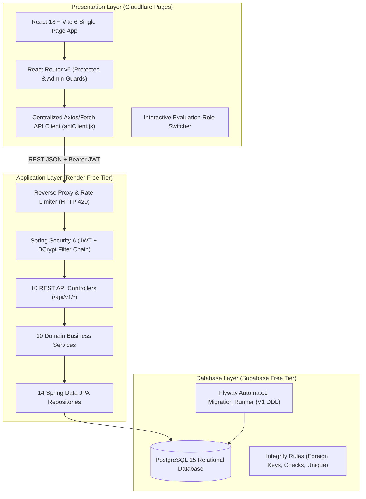

# 🔄 Skill Swap Network

[]()
[]()
[]()
[]()
[]()
[]()
[-336791.svg)]()
[]()

> A modern, full-stack peer-to-peer knowledge and skill-sharing web application developed for the Software Engineering project.

---

## 🌟 Overview

**Skill Swap Network** enables members to exchange skills in a direct, credit-less, payment-free peer-to-peer barter ecosystem. Whether teaching conversational Spanish in exchange for web development mentorship, or swapping guitar lessons for digital photography, users discover complementary partners through a two-way reciprocal barter algorithm, negotiate agreements, schedule lessons, and build verified reputation trust.

### Key Highlights
- **Strict Non-Monetary Policy (NFR-07):** Zero currencies, subscriptions, credits, or transaction fees. Pure bilateral skill barter.
- **Two-Way Reciprocal Barter Matching:** Prioritizes mutual barter pairs ($A \text{ teaches } B \land B \text{ teaches } A$) with compatibility percentages and transparent reasoning.
- **Interactive Role Switcher:** Top demo bar enables instant, one-click previewing between **Public Guest**, **Member (Sarah)**, and **Admin (David)** for seamless evaluation.
- **Comprehensive Security:** BCrypt password hashing, stateless JWT with blacklist logout, sliding-window rate limiting on login/registration, and strict public profile data stripping.
- **100% Free-Tier Cloud Deployment:** Zero paid APIs or subscriptions (Cloudflare Pages + Render + Supabase).

---

## 📐 System Architecture

The application implements a decoupled, strict **Three-Layer Architecture**:



---

## 🚀 Technology Stack

| Layer | Technologies | Purpose |
| :--- | :--- | :--- |
| **Frontend** | React 18, Vite 6, JavaScript (ES6+), HTML5, CSS3 Tokens | Ultra-fast client-side SPA with custom design system. |
| **Backend** | Java 17+, Spring Boot 3.3.5, Spring Web, Spring Security, Data JPA | Layered REST API handling business logic and access control. |
| **Database** | PostgreSQL 15, Supabase, Flyway Migrations | Relational persistence with ACID transactions and integrity constraints. |
| **Security** | BCrypt, JJWT (0.12.6), Sliding-Window Rate Limiter | Secure salted password hashing, signed tokens, clickjacking protection. |
| **DevOps & Hosting** | Cloudflare Pages, Render (Docker), GitHub Actions | 100% free-tier cloud deployment with zero ongoing operational costs. |

---

## 📋 SRS Requirements Traceability

The system fulfills all 13 Functional Requirements, 8 User Stories, and 7 Non-Functional Requirements:

- **FR-01: User Account Management** — BCrypt registration, JWT login, token blacklist logout.
- **FR-02: User Profile Management** — Private profile updates, sanitized public profile viewing.
- **FR-03: Teaching Skill Management** — Inventory CRUD, case-insensitive duplicate skill rejection.
- **FR-04: Learning Skill Management** — Goal CRUD, priority tags, duplicate goal rejection.
- **FR-05: Search & Filter** — Keyword search, category filter, rating filter, empty state UI.
- **FR-06: Skill Matching & Recommendations** — Two-way reciprocal barter algorithm with match scores.
- **FR-07: Exchange Request Management** — Barter proposals with self-swap and same-skill prevention.
- **FR-08: Request Status Management** — `PENDING` $\rightarrow$ `ACCEPTED` / `DECLINED` / `CANCELLED` state machine.
- **FR-09: Communication & Lesson Arrangement** — Direct chat threads, virtual lesson scheduling.
- **FR-10: Exchange Completion Management** — Session counter progress meters, dual completion sign-off.
- **FR-11: Ratings & Feedback Submission** — Post-completion 1–5 star reviews, duplicate feedback rejection.
- **FR-12: Profile & Feedback Viewing** — Verified peer review displays, aggregated trust scores.
- **FR-13: Administration & Content Moderation** — Safety reporting, admin queue, account suspension.

---

## 🛠️ Quick Start (Local Development)

### Prerequisites
- **Node.js:** v18+ (v20+ recommended)
- **Java JDK:** 17 or higher
- **Git**

### 1. Clone Repository
```bash
git clone https://github.com/eissa01h/Skill-Swap-Network.git
cd Skill-Swap-Network
```

### 2. Run Frontend
```bash
cd frontend
npm install
npm run dev
```
Open [http://localhost:5173](http://localhost:5173) in your browser.

### 3. Run Backend (Optional — Frontend features built-in fallback for instant offline preview)
```bash
cd ../backend
./mvnw spring-boot:run
```
Backend runs on `http://localhost:8080/api/v1`. API documentation is available at `http://localhost:8080/swagger-ui.html`.

### 4. Execute Automated Test Suites
```bash
node --test test/*.test.js
```
Executes all 36 functional, user story, non-functional, and edge-case test suites.

---

## ☁️ Production Deployment Architecture (Free Tier)

| Service | Provider | Configuration | Cost |
| :--- | :--- | :--- | :---: |
| **Frontend SPA** | Cloudflare Pages | Connect GitHub $\rightarrow$ `npm run build` $\rightarrow$ Output `dist` | **$0.00** |
| **Backend API** | Render Web Service | Connect GitHub $\rightarrow$ Docker build (`backend/Dockerfile`) | **$0.00** |
| **PostgreSQL DB** | Supabase Free Tier | Managed PostgreSQL with connection pooling & SSL | **$0.00** |

---

## 📚 Complete Project Documentation

All design, architectural, testing, and deployment documents are maintained in the [`docs/`](file:///c:/Users/AIRIN/OneDrive/Desktop/SE%20PRO/docs/) directory:

1. [Architecture & SRS Mapping](file:///c:/Users/AIRIN/OneDrive/Desktop/SE%20PRO/docs/architecture.md)
2. [Database Design & ER Diagrams](file:///c:/Users/AIRIN/OneDrive/Desktop/SE%20PRO/docs/database-design.md)
3. [REST API Documentation](file:///c:/Users/AIRIN/OneDrive/Desktop/SE%20PRO/docs/api-documentation.md)
4. [Security & Privacy Guide](file:///c:/Users/AIRIN/OneDrive/Desktop/SE%20PRO/docs/security.md)
5. [Test Cases Specification](file:///c:/Users/AIRIN/OneDrive/Desktop/SE%20PRO/docs/test-cases.md)
6. [Test Execution Results](file:///c:/Users/AIRIN/OneDrive/Desktop/SE%20PRO/docs/test-results.md)
7. [Requirements Traceability Matrix (RTM)](file:///c:/Users/AIRIN/OneDrive/Desktop/SE%20PRO/docs/requirements-traceability-matrix.md)
8. [Final QA Report](file:///c:/Users/AIRIN/OneDrive/Desktop/SE%20PRO/docs/qa-report.md)
9. [Free-Tier Deployment Guide](file:///c:/Users/AIRIN/OneDrive/Desktop/SE%20PRO/docs/deployment-guide.md)
10. [Local Development & Setup Guide](file:///c:/Users/AIRIN/OneDrive/Desktop/SE%20PRO/docs/setup-guide.md)
11. [Final Project Handover Document](file:///c:/Users/AIRIN/OneDrive/Desktop/SE%20PRO/docs/handover.md)
12. [Development Progress Log](file:///c:/Users/AIRIN/OneDrive/Desktop/SE%20PRO/docs/progress.md)

---

## 📄 License
This project was developed for the Software Engineering course curriculum. Code released under the [MIT License](LICENSE).
