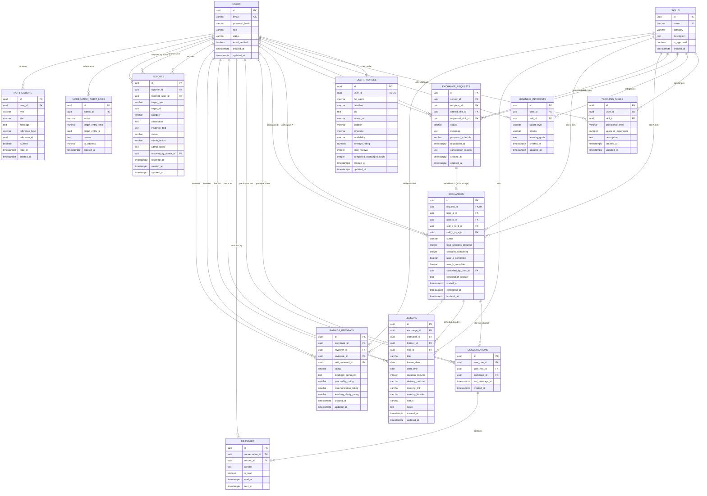

# Database Design Specification: Skill Swap Network

**Document Version:** 2.0  
**Status:** Approved & Implemented  
**Engine:** PostgreSQL 15+ (Hosted on Supabase Free-Tier)  
**Migration Tool:** Flyway Database Migrations (`db/migration/V1__initial_schema.sql`)  
**Traceability:** Implements and enforces FR-01 through FR-13, NFR-01 through NFR-07, and US-01 through US-08.

---

## 1. Relational Database Overview & Architectural Principles

Skill Swap Network utilizes **PostgreSQL** configured with strict referential integrity, check constraints, composite unique indexes, and version-controlled Flyway migrations.

### Key Architectural Tenets:
1. **Third Normal Form (3NF) Normalization:** Separation of identity/authentication (`users`) from public persona (`user_profiles`), master catalogs (`skills`), user skill listings (`teaching_skills`, `learning_interests`), and stateful transactions (`exchange_requests`, `exchanges`, `lessons`, `ratings_feedback`).
2. **Deterministic Primary Keys:** All tables use **UUID v4** (`DEFAULT gen_random_uuid()`), preventing enumeration attacks, facilitating distributed generation, and simplifying testing.
3. **Password Security (NFR-02):** Plaintext passwords are strictly banned. Credentials are stored exclusively as salted BCrypt hashes in `password_hash VARCHAR(255)`.
4. **Duplicate Prevention (Data Integrity):** Composite unique constraints ensure:
   - A user cannot list the same teaching skill twice (`UNIQUE (user_id, skill_id)`).
   - A user cannot list the same learning goal twice (`UNIQUE (user_id, skill_id)`).
   - A participant cannot review the same completed exchange twice (`UNIQUE (exchange_id, reviewer_id)`).
   - Duplicate direct conversations between the same pair of users are impossible (`UNIQUE (user_one_id, user_two_id)`).
5. **Strict Non-Monetary Peer Barter (NFR-05):** In adherence to the SRS, the database contains zero monetary fields, currency types, wallet balances, or credit purchase systems. Exchanges operate on direct skill reciprocity.
6. **Non-Destructive Versioned Migrations:** The schema is managed through Flyway (`V1__initial_schema.sql`). Automatic schema generation (`hibernate.ddl-auto=create` or `update`) is disabled in favor of deterministic, repeatable migrations validated via `validate`.

---

## 2. Complete Entity-Relationship (ER) Diagram



---

## 3. Detailed Table Specifications & Constraints

### 3.1 `users` Table
Handles core account credentials, authentication identities, and platform access status.

| Column | Type | Constraints | Description |
| :--- | :--- | :--- | :--- |
| `id` | `UUID` | `PRIMARY KEY, DEFAULT gen_random_uuid()` | Immutable internal identifier. |
| `email` | `VARCHAR(255)` | `NOT NULL, UNIQUE` | Normalized login address. Case-insensitive indexed. |
| `password_hash` | `VARCHAR(255)` | `NOT NULL` | Salted BCrypt password hash (never plaintext). |
| `role` | `VARCHAR(30)` | `NOT NULL, DEFAULT 'ROLE_USER'` | Authority: `ROLE_USER`, `ROLE_ADMIN`, `ROLE_MODERATOR`. |
| `status` | `VARCHAR(30)` | `NOT NULL, DEFAULT 'ACTIVE'` | Lifecycle: `ACTIVE`, `SUSPENDED`, `BLOCKED`, `DEACTIVATED`. |
| `email_verified` | `BOOLEAN` | `NOT NULL, DEFAULT FALSE` | Email confirmation flag. |
| `created_at` | `TIMESTAMPTZ` | `NOT NULL, DEFAULT NOW()` | Account registration timestamp. |
| `updated_at` | `TIMESTAMPTZ` | `NOT NULL, DEFAULT NOW()` | Record modification timestamp. |

- **Table Constraints:**
  - `CONSTRAINT uk_users_email UNIQUE (email)`
  - `CONSTRAINT chk_users_role CHECK (role IN ('ROLE_USER', 'ROLE_ADMIN', 'ROLE_MODERATOR'))`
  - `CONSTRAINT chk_users_status CHECK (status IN ('ACTIVE', 'SUSPENDED', 'BLOCKED', 'DEACTIVATED'))`

---

### 3.2 `user_profiles` Table
Stores public biographical information, geographical location, scheduling preferences, and calculated reputation metrics.

| Column | Type | Constraints | Description |
| :--- | :--- | :--- | :--- |
| `id` | `UUID` | `PRIMARY KEY, DEFAULT gen_random_uuid()` | Profile record ID. |
| `user_id` | `UUID` | `NOT NULL, UNIQUE, FK -> users(id)` | 1:1 relationship with `users`. Cascades on user deletion. |
| `full_name` | `VARCHAR(120)` | `NOT NULL` | Display name of the user. |
| `headline` | `VARCHAR(180)` | `NULL` | Brief professional headline or learning summary. |
| `bio` | `TEXT` | `NULL` | Detailed introduction and teaching/learning goals. |
| `avatar_url` | `VARCHAR(500)` | `NULL` | Public CDN / Supabase Storage image URL. |
| `location` | `VARCHAR(120)` | `NULL` | City, State, or Country. |
| `timezone` | `VARCHAR(50)` | `DEFAULT 'UTC'` | User standard timezone identifier. |
| `availability` | `VARCHAR(150)` | `NULL` | Availability text (e.g., "Weekends, Weekday Evenings"). |
| `average_rating` | `NUMERIC(3,2)` | `NOT NULL, DEFAULT 0.00` | Rolling average rating computed from `ratings_feedback`. |
| `total_reviews` | `INTEGER` | `NOT NULL, DEFAULT 0` | Verified peer reviews count. |
| `completed_exchanges_count` | `INTEGER` | `NOT NULL, DEFAULT 0` | Total completed skill exchanges. |
| `created_at` | `TIMESTAMPTZ` | `NOT NULL, DEFAULT NOW()` | Profile creation timestamp. |
| `updated_at` | `TIMESTAMPTZ` | `NOT NULL, DEFAULT NOW()` | Profile update timestamp. |

- **Table Constraints:**
  - `CONSTRAINT uk_user_profiles_user_id UNIQUE (user_id)`
  - `CONSTRAINT fk_user_profiles_users FOREIGN KEY (user_id) REFERENCES users(id) ON DELETE CASCADE`
  - `CONSTRAINT chk_profiles_rating CHECK (average_rating >= 0.00 AND average_rating <= 5.00)`
  - `CONSTRAINT chk_profiles_reviews CHECK (total_reviews >= 0)`
  - `CONSTRAINT chk_profiles_exchanges CHECK (completed_exchanges_count >= 0)`

---

### 3.3 `skills` Table
Standardized master repository of categorized knowledge areas, arts, languages, and technical disciplines.

| Column | Type | Constraints | Description |
| :--- | :--- | :--- | :--- |
| `id` | `UUID` | `PRIMARY KEY, DEFAULT gen_random_uuid()` | Unique skill identifier. |
| `name` | `VARCHAR(100)` | `NOT NULL, UNIQUE` | Standardized title (e.g. "React Architecture"). |
| `category` | `VARCHAR(80)` | `NOT NULL` | Master group (e.g. "Programming & Tech", "Languages"). |
| `description` | `TEXT` | `NULL` | Scope and curriculum overview. |
| `is_approved` | `BOOLEAN` | `NOT NULL, DEFAULT TRUE` | Admin curation status for user-submitted topics. |
| `created_at` | `TIMESTAMPTZ` | `NOT NULL, DEFAULT NOW()` | Skill catalog entry timestamp. |

- **Table Constraints:**
  - `CONSTRAINT uk_skills_name UNIQUE (name)`
  - `CONSTRAINT chk_skills_category CHECK (category IN ('Programming & Tech', 'Languages', 'Design & Creative', 'Music & Audio', 'Business & Marketing', 'Academics & Science', 'Lifestyle & Wellness'))`

---

### 3.4 `teaching_skills` Table
Maintains skills a member is qualified and willing to instruct.

| Column | Type | Constraints | Description |
| :--- | :--- | :--- | :--- |
| `id` | `UUID` | `PRIMARY KEY, DEFAULT gen_random_uuid()` | Record identifier. |
| `user_id` | `UUID` | `NOT NULL, FK -> users(id)` | Instructor user ID. Cascades on user deletion. |
| `skill_id` | `UUID` | `NOT NULL, FK -> skills(id)` | Taught skill. Deletion restricted if referenced. |
| `proficiency_level` | `VARCHAR(30)` | `NOT NULL` | `BEGINNER`, `INTERMEDIATE`, `ADVANCED`, `EXPERT`. |
| `years_of_experience` | `NUMERIC(3,1)` | `NULL` | Experience in years (e.g. 4.5). |
| `description` | `TEXT` | `NULL` | Curriculum, sample projects, or teaching approach. |
| `created_at` | `TIMESTAMPTZ` | `NOT NULL, DEFAULT NOW()` | Date skill was listed. |
| `updated_at` | `TIMESTAMPTZ` | `NOT NULL, DEFAULT NOW()` | Date skill was updated. |

- **Table Constraints:**
  - `CONSTRAINT uk_teaching_skills_user_skill UNIQUE (user_id, skill_id)` **(Prevents duplicate skills per user)**
  - `CONSTRAINT fk_teaching_skills_users FOREIGN KEY (user_id) REFERENCES users(id) ON DELETE CASCADE`
  - `CONSTRAINT fk_teaching_skills_skills FOREIGN KEY (skill_id) REFERENCES skills(id) ON DELETE RESTRICT`
  - `CONSTRAINT chk_teaching_proficiency CHECK (proficiency_level IN ('BEGINNER', 'INTERMEDIATE', 'ADVANCED', 'EXPERT'))`
  - `CONSTRAINT chk_teaching_experience CHECK (years_of_experience >= 0)`

---

### 3.5 `learning_interests` Table
Maintains knowledge topics a member actively desires to acquire.

| Column | Type | Constraints | Description |
| :--- | :--- | :--- | :--- |
| `id` | `UUID` | `PRIMARY KEY, DEFAULT gen_random_uuid()` | Record identifier. |
| `user_id` | `UUID` | `NOT NULL, FK -> users(id)` | Learner user ID. Cascades on user deletion. |
| `skill_id` | `UUID` | `NOT NULL, FK -> skills(id)` | Desired skill. Deletion restricted if referenced. |
| `target_level` | `VARCHAR(30)` | `NOT NULL` | Goal proficiency: `BEGINNER`, `INTERMEDIATE`, `ADVANCED`, `EXPERT`. |
| `priority` | `VARCHAR(20)` | `NOT NULL, DEFAULT 'MEDIUM'` | `LOW`, `MEDIUM`, `HIGH`. |
| `learning_goals` | `TEXT` | `NULL` | Specific objectives or projects desired. |
| `created_at` | `TIMESTAMPTZ` | `NOT NULL, DEFAULT NOW()` | Date interest was registered. |
| `updated_at` | `TIMESTAMPTZ` | `NOT NULL, DEFAULT NOW()` | Date interest was updated. |

- **Table Constraints:**
  - `CONSTRAINT uk_learning_interests_user_skill UNIQUE (user_id, skill_id)` **(Prevents duplicate interests per user)**
  - `CONSTRAINT fk_learning_interests_users FOREIGN KEY (user_id) REFERENCES users(id) ON DELETE CASCADE`
  - `CONSTRAINT fk_learning_interests_skills FOREIGN KEY (skill_id) REFERENCES skills(id) ON DELETE RESTRICT`
  - `CONSTRAINT chk_learning_target_level CHECK (target_level IN ('BEGINNER', 'INTERMEDIATE', 'ADVANCED', 'EXPERT'))`
  - `CONSTRAINT chk_learning_priority CHECK (priority IN ('LOW', 'MEDIUM', 'HIGH'))`

---

### 3.6 `exchange_requests` Table
Represents proposed reciprocal skill barter agreements between a sender and recipient.

| Column | Type | Constraints | Description |
| :--- | :--- | :--- | :--- |
| `id` | `UUID` | `PRIMARY KEY, DEFAULT gen_random_uuid()` | Unique proposal identifier. |
| `sender_id` | `UUID` | `NOT NULL, FK -> users(id)` | Initiating member. |
| `recipient_id` | `UUID` | `NOT NULL, FK -> users(id)` | Target partner. |
| `offered_skill_id` | `UUID` | `NOT NULL, FK -> skills(id)` | Skill sender offers to teach. |
| `requested_skill_id` | `UUID` | `NOT NULL, FK -> skills(id)` | Skill sender requests to learn. |
| `status` | `VARCHAR(30)` | `NOT NULL, DEFAULT 'PENDING'` | `PENDING`, `ACCEPTED`, `DECLINED`, `CANCELLED`, `EXPIRED`. |
| `message` | `TEXT` | `NULL` | Personal introductory message and context. |
| `proposed_schedule` | `VARCHAR(255)` | `NULL` | Preferred meeting days/cadence. |
| `responded_at` | `TIMESTAMPTZ` | `NULL` | Timestamp when recipient accepted or declined. |
| `cancellation_reason` | `TEXT` | `NULL` | Reason provided if cancelled prior to acceptance. |
| `created_at` | `TIMESTAMPTZ` | `NOT NULL, DEFAULT NOW()` | Proposal creation date. |
| `updated_at` | `TIMESTAMPTZ` | `NOT NULL, DEFAULT NOW()` | Proposal modification date. |

- **Table Constraints:**
  - `CONSTRAINT fk_exchange_requests_sender FOREIGN KEY (sender_id) REFERENCES users(id) ON DELETE CASCADE`
  - `CONSTRAINT fk_exchange_requests_recipient FOREIGN KEY (recipient_id) REFERENCES users(id) ON DELETE CASCADE`
  - `CONSTRAINT fk_exchange_requests_offered_skill FOREIGN KEY (offered_skill_id) REFERENCES skills(id) ON DELETE RESTRICT`
  - `CONSTRAINT fk_exchange_requests_requested_skill FOREIGN KEY (requested_skill_id) REFERENCES skills(id) ON DELETE RESTRICT`
  - `CONSTRAINT chk_exchange_requests_distinct_users CHECK (sender_id <> recipient_id)`
  - `CONSTRAINT chk_exchange_requests_distinct_skills CHECK (offered_skill_id <> requested_skill_id)`
  - `CONSTRAINT chk_exchange_requests_status CHECK (status IN ('PENDING', 'ACCEPTED', 'DECLINED', 'CANCELLED', 'EXPIRED'))`

---

### 3.7 `exchanges` Table
Represents an active, ongoing, or concluded contract between two members resulting from an accepted request.

| Column | Type | Constraints | Description |
| :--- | :--- | :--- | :--- |
| `id` | `UUID` | `PRIMARY KEY, DEFAULT gen_random_uuid()` | Unique exchange identifier. |
| `request_id` | `UUID` | `NOT NULL, UNIQUE, FK -> exchange_requests(id)` | 1:1 reference to accepted proposal. |
| `user_a_id` | `UUID` | `NOT NULL, FK -> users(id)` | Original proposal sender. |
| `user_b_id` | `UUID` | `NOT NULL, FK -> users(id)` | Original proposal recipient. |
| `skill_a_to_b_id` | `UUID` | `NOT NULL, FK -> skills(id)` | Skill taught by User A to User B. |
| `skill_b_to_a_id` | `UUID` | `NOT NULL, FK -> skills(id)` | Skill taught by User B to User A. |
| `status` | `VARCHAR(30)` | `NOT NULL, DEFAULT 'ACTIVE'` | `ACTIVE`, `COMPLETED`, `CANCELLED`, `DISPUTED`. |
| `total_sessions_planned` | `INTEGER` | `NOT NULL, DEFAULT 4` | Total planned exchange sessions. |
| `sessions_completed` | `INTEGER` | `NOT NULL, DEFAULT 0` | Verified sessions completed. |
| `user_a_completed` | `BOOLEAN` | `NOT NULL, DEFAULT FALSE` | User A completion sign-off. |
| `user_b_completed` | `BOOLEAN` | `NOT NULL, DEFAULT FALSE` | User B completion sign-off. |
| `cancelled_by_user_id` | `UUID` | `NULL, FK -> users(id)` | Participant who initiated cancellation. |
| `cancellation_reason` | `TEXT` | `NULL` | Explanation for premature termination. |
| `started_at` | `TIMESTAMPTZ` | `NOT NULL, DEFAULT NOW()` | Date exchange commenced. |
| `completed_at` | `TIMESTAMPTZ` | `NULL` | Date both parties verified completion. |
| `updated_at` | `TIMESTAMPTZ` | `NOT NULL, DEFAULT NOW()` | Last update timestamp. |

- **Table Constraints:**
  - `CONSTRAINT uk_exchanges_request_id UNIQUE (request_id)`
  - `CONSTRAINT fk_exchanges_request FOREIGN KEY (request_id) REFERENCES exchange_requests(id) ON DELETE RESTRICT`
  - `CONSTRAINT fk_exchanges_user_a FOREIGN KEY (user_a_id) REFERENCES users(id) ON DELETE CASCADE`
  - `CONSTRAINT fk_exchanges_user_b FOREIGN KEY (user_b_id) REFERENCES users(id) ON DELETE CASCADE`
  - `CONSTRAINT fk_exchanges_skill_a FOREIGN KEY (skill_a_to_b_id) REFERENCES skills(id) ON DELETE RESTRICT`
  - `CONSTRAINT fk_exchanges_skill_b FOREIGN KEY (skill_b_to_a_id) REFERENCES skills(id) ON DELETE RESTRICT`
  - `CONSTRAINT fk_exchanges_cancelled_by FOREIGN KEY (cancelled_by_user_id) REFERENCES users(id) ON DELETE SET NULL`
  - `CONSTRAINT chk_exchanges_distinct_users CHECK (user_a_id <> user_b_id)`
  - `CONSTRAINT chk_exchanges_status CHECK (status IN ('ACTIVE', 'COMPLETED', 'CANCELLED', 'DISPUTED'))`
  - `CONSTRAINT chk_exchanges_sessions CHECK (sessions_completed >= 0 AND sessions_completed <= total_sessions_planned)`
  - `CONSTRAINT chk_exchanges_planned CHECK (total_sessions_planned > 0)`

---

### 3.8 `conversations` & `messages` Tables
Enforces private, 1-on-1 direct messaging between members.

#### `conversations` Table
| Column | Type | Constraints | Description |
| :--- | :--- | :--- | :--- |
| `id` | `UUID` | `PRIMARY KEY, DEFAULT gen_random_uuid()` | Conversation thread ID. |
| `user_one_id` | `UUID` | `NOT NULL, FK -> users(id)` | Lower UUID user in pair. |
| `user_two_id` | `UUID` | `NOT NULL, FK -> users(id)` | Higher UUID user in pair. |
| `exchange_id` | `UUID` | `NULL, FK -> exchanges(id)` | Optional link to active exchange. |
| `last_message_at` | `TIMESTAMPTZ` | `NOT NULL, DEFAULT NOW()` | Timestamp of newest message. |
| `created_at` | `TIMESTAMPTZ` | `NOT NULL, DEFAULT NOW()` | Thread creation timestamp. |

- **Table Constraints:**
  - `CONSTRAINT chk_conversations_user_order CHECK (user_one_id < user_two_id)` **(Enforces canonical ordering)**
  - `CONSTRAINT uk_conversations_pair UNIQUE (user_one_id, user_two_id)` **(Guarantees exactly 1 thread per user pair)**

#### `messages` Table
| Column | Type | Constraints | Description |
| :--- | :--- | :--- | :--- |
| `id` | `UUID` | `PRIMARY KEY, DEFAULT gen_random_uuid()` | Individual message ID. |
| `conversation_id` | `UUID` | `NOT NULL, FK -> conversations(id)` | Parent conversation. Cascades on delete. |
| `sender_id` | `UUID` | `NOT NULL, FK -> users(id)` | Message author. Cascades on user delete. |
| `content` | `TEXT` | `NOT NULL` | Message body (trimmed, non-empty). |
| `is_read` | `BOOLEAN` | `NOT NULL, DEFAULT FALSE` | Read receipt indicator. |
| `read_at` | `TIMESTAMPTZ` | `NULL` | Timestamp recipient read message. |
| `sent_at` | `TIMESTAMPTZ` | `NOT NULL, DEFAULT NOW()` | Time sent. |

- **Table Constraints:**
  - `CONSTRAINT fk_messages_conversation FOREIGN KEY (conversation_id) REFERENCES conversations(id) ON DELETE CASCADE`
  - `CONSTRAINT fk_messages_sender FOREIGN KEY (sender_id) REFERENCES users(id) ON DELETE CASCADE`
  - `CONSTRAINT chk_messages_content_not_empty CHECK (length(trim(content)) > 0)`

---

### 3.9 `lessons` Table
Facilitates collaborative scheduling of individual teaching and learning sessions under an active exchange.

| Column | Type | Constraints | Description |
| :--- | :--- | :--- | :--- |
| `id` | `UUID` | `PRIMARY KEY, DEFAULT gen_random_uuid()` | Lesson session ID. |
| `exchange_id` | `UUID` | `NOT NULL, FK -> exchanges(id)` | Associated skill exchange agreement. |
| `instructor_id` | `UUID` | `NOT NULL, FK -> users(id)` | Partner teaching during this specific lesson. |
| `learner_id` | `UUID` | `NOT NULL, FK -> users(id)` | Partner learning during this lesson. |
| `skill_id` | `UUID` | `NOT NULL, FK -> skills(id)` | Topic covered during this lesson. |
| `title` | `VARCHAR(200)` | `NOT NULL` | Lesson agenda/topic summary. |
| `lesson_date` | `DATE` | `NOT NULL` | Calendar date of meeting. |
| `start_time` | `TIME` | `NOT NULL` | Planned start time. |
| `duration_minutes` | `INTEGER` | `NOT NULL, DEFAULT 60` | Duration (1 to 360 minutes). |
| `delivery_method` | `VARCHAR(50)` | `NOT NULL, DEFAULT 'ONLINE_VIDEO'` | `ONLINE_VIDEO`, `IN_PERSON`, `AUDIO_CALL`. |
| `meeting_link` | `VARCHAR(500)` | `NULL` | Video room URL (e.g. Jitsi Meet). |
| `meeting_location` | `VARCHAR(255)` | `NULL` | Physical venue if in-person. |
| `status` | `VARCHAR(30)` | `NOT NULL, DEFAULT 'SCHEDULED'` | `SCHEDULED`, `COMPLETED`, `CANCELLED`, `RESCHEDULED`. |
| `notes` | `TEXT` | `NULL` | Pre-session homework or prep materials. |
| `created_at` | `TIMESTAMPTZ` | `NOT NULL, DEFAULT NOW()` | Record creation date. |
| `updated_at` | `TIMESTAMPTZ` | `NOT NULL, DEFAULT NOW()` | Record modification date. |

- **Table Constraints:**
  - `CONSTRAINT fk_lessons_exchange FOREIGN KEY (exchange_id) REFERENCES exchanges(id) ON DELETE CASCADE`
  - `CONSTRAINT fk_lessons_instructor FOREIGN KEY (instructor_id) REFERENCES users(id) ON DELETE CASCADE`
  - `CONSTRAINT fk_lessons_learner FOREIGN KEY (learner_id) REFERENCES users(id) ON DELETE CASCADE`
  - `CONSTRAINT fk_lessons_skill FOREIGN KEY (skill_id) REFERENCES skills(id) ON DELETE RESTRICT`
  - `CONSTRAINT chk_lessons_distinct_participants CHECK (instructor_id <> learner_id)`
  - `CONSTRAINT chk_lessons_duration CHECK (duration_minutes > 0 AND duration_minutes <= 360)`
  - `CONSTRAINT chk_lessons_delivery CHECK (delivery_method IN ('ONLINE_VIDEO', 'IN_PERSON', 'AUDIO_CALL'))`
  - `CONSTRAINT chk_lessons_status CHECK (status IN ('SCHEDULED', 'COMPLETED', 'CANCELLED', 'RESCHEDULED'))`

---

### 3.10 `ratings_feedback` Table
Collects verified peer testimonials and quantitative performance ratings following completed exchanges.

| Column | Type | Constraints | Description |
| :--- | :--- | :--- | :--- |
| `id` | `UUID` | `PRIMARY KEY, DEFAULT gen_random_uuid()` | Unique review ID. |
| `exchange_id` | `UUID` | `NOT NULL, FK -> exchanges(id)` | Completed exchange reference. |
| `reviewer_id` | `UUID` | `NOT NULL, FK -> users(id)` | Submitting participant. |
| `reviewee_id` | `UUID` | `NOT NULL, FK -> users(id)` | Partner being evaluated. |
| `skill_reviewed_id` | `UUID` | `NOT NULL, FK -> skills(id)` | Skill evaluated. |
| `rating` | `SMALLINT` | `NOT NULL` | Overall score (1 to 5 stars). |
| `feedback_comment` | `TEXT` | `NOT NULL` | Written commentary (min 5 chars). |
| `punctuality_rating` | `SMALLINT` | `NULL` | Sub-score (1 to 5). |
| `communication_rating` | `SMALLINT` | `NULL` | Sub-score (1 to 5). |
| `teaching_clarity_rating`| `SMALLINT`| `NULL` | Sub-score (1 to 5). |
| `created_at` | `TIMESTAMPTZ` | `NOT NULL, DEFAULT NOW()` | Review submission date. |
| `updated_at` | `TIMESTAMPTZ` | `NOT NULL, DEFAULT NOW()` | Review edit date. |

- **Table Constraints:**
  - `CONSTRAINT uk_ratings_exchange_reviewer UNIQUE (exchange_id, reviewer_id)` **(Guarantees exactly 1 review per participant per exchange)**
  - `CONSTRAINT fk_ratings_exchange FOREIGN KEY (exchange_id) REFERENCES exchanges(id) ON DELETE RESTRICT`
  - `CONSTRAINT fk_ratings_reviewer FOREIGN KEY (reviewer_id) REFERENCES users(id) ON DELETE CASCADE`
  - `CONSTRAINT fk_ratings_reviewee FOREIGN KEY (reviewee_id) REFERENCES users(id) ON DELETE CASCADE`
  - `CONSTRAINT fk_ratings_skill FOREIGN KEY (skill_reviewed_id) REFERENCES skills(id) ON DELETE RESTRICT`
  - `CONSTRAINT chk_ratings_distinct_users CHECK (reviewer_id <> reviewee_id)`
  - `CONSTRAINT chk_ratings_score CHECK (rating >= 1 AND rating <= 5)`
  - `CONSTRAINT chk_ratings_comment_length CHECK (length(trim(feedback_comment)) >= 5)`
  - `CONSTRAINT chk_ratings_punctuality CHECK (punctuality_rating IS NULL OR (punctuality_rating >= 1 AND punctuality_rating <= 5))`
  - `CONSTRAINT chk_ratings_communication CHECK (communication_rating IS NULL OR (communication_rating >= 1 AND communication_rating <= 5))`
  - `CONSTRAINT chk_ratings_clarity CHECK (teaching_clarity_rating IS NULL OR (teaching_clarity_rating >= 1 AND teaching_clarity_rating <= 5))`

---

### 3.11 `reports` & `moderation_audit_logs` Tables
Enforces platform safety, zero-cost compliance, and community standard moderation.

#### `reports` Table
| Column | Type | Constraints | Description |
| :--- | :--- | :--- | :--- |
| `id` | `UUID` | `PRIMARY KEY, DEFAULT gen_random_uuid()` | Incident report ID. |
| `reporter_id` | `UUID` | `NOT NULL, FK -> users(id)` | Reporting user. |
| `reported_user_id` | `UUID` | `NOT NULL, FK -> users(id)` | Reported member. |
| `target_type` | `VARCHAR(50)` | `NOT NULL` | `USER_PROFILE`, `MESSAGE`, `EXCHANGE`, `REVIEW`, `COMMERCIAL_SOLICITATION`. |
| `target_id` | `UUID` | `NULL` | Optional reference to specific message/review ID. |
| `category` | `VARCHAR(80)` | `NOT NULL` | `COMMERCIAL_SOLICITATION`, `HARASSMENT`, `SPAM`, `NO_SHOW`, `INAPPROPRIATE_CONTENT`, `OTHER`. |
| `description` | `TEXT` | `NOT NULL` | Detailed statement from complainant. |
| `evidence_text` | `TEXT` | `NULL` | Chat transcript snippet or link evidence. |
| `status` | `VARCHAR(30)` | `NOT NULL, DEFAULT 'PENDING'` | `PENDING`, `UNDER_INVESTIGATION`, `RESOLVED`, `DISMISSED`. |
| `admin_action` | `VARCHAR(50)` | `DEFAULT 'NONE'` | `NONE`, `WARNING_ISSUED`, `CONTENT_REMOVED`, `ACCOUNT_BLOCKED`, `ACCOUNT_BANNED`, `DISMISSED`. |
| `admin_notes` | `TEXT` | `NULL` | Internal staff investigation notes. |
| `resolved_by_admin_id`| `UUID` | `NULL, FK -> users(id)` | Staff member who resolved report. |
| `resolved_at` | `TIMESTAMPTZ` | `NULL` | Resolution timestamp. |
| `created_at` | `TIMESTAMPTZ` | `NOT NULL, DEFAULT NOW()` | Report submission date. |
| `updated_at` | `TIMESTAMPTZ` | `NOT NULL, DEFAULT NOW()` | Status update timestamp. |

#### `moderation_audit_logs` Table
| Column | Type | Constraints | Description |
| :--- | :--- | :--- | :--- |
| `id` | `UUID` | `PRIMARY KEY, DEFAULT gen_random_uuid()` | Audit log ID. |
| `admin_id` | `UUID` | `NOT NULL, FK -> users(id)` | Staff actor ID. |
| `action` | `VARCHAR(80)` | `NOT NULL` | Action taken (e.g. `ACCOUNT_BLOCKED`, `REPORT_RESOLVED`). |
| `target_entity_type` | `VARCHAR(50)` | `NOT NULL` | Entity affected (`USER`, `REPORT`, `REVIEW`, `SKILL`). |
| `target_entity_id` | `UUID` | `NOT NULL` | Target UUID. |
| `reason` | `TEXT` | `NOT NULL` | Administrative justification. |
| `ip_address` | `VARCHAR(45)` | `NULL` | Client IP address for audit compliance. |
| `created_at` | `TIMESTAMPTZ` | `NOT NULL, DEFAULT NOW()` | Immutable log creation timestamp. |

---

### 3.12 `notifications` Table
Real-time, persistent event dispatch for exchange milestones and administrative notices.

| Column | Type | Constraints | Description |
| :--- | :--- | :--- | :--- |
| `id` | `UUID` | `PRIMARY KEY, DEFAULT gen_random_uuid()` | Notification ID. |
| `user_id` | `UUID` | `NOT NULL, FK -> users(id)` | Recipient user ID. Cascades on user delete. |
| `type` | `VARCHAR(50)` | `NOT NULL` | Event type enum. |
| `title` | `VARCHAR(150)` | `NOT NULL` | Brief alert headline. |
| `message` | `TEXT` | `NOT NULL` | Full alert description. |
| `reference_type` | `VARCHAR(50)` | `NULL` | E.g. `EXCHANGE_REQUEST`, `EXCHANGE`, `LESSON`, `REVIEW`. |
| `reference_id` | `UUID` | `NULL` | Related entity UUID for one-click deep linking. |
| `is_read` | `BOOLEAN` | `NOT NULL, DEFAULT FALSE` | Unread flag. |
| `read_at` | `TIMESTAMPTZ` | `NULL` | Timestamp user read notification. |
| `created_at` | `TIMESTAMPTZ` | `NOT NULL, DEFAULT NOW()` | Notification dispatch time. |

---

## 4. Exchange Lifecycle & Cancellation Rules Matrix

The exchange lifecycle guarantees deterministic state progressions between the proposal phase, active execution, completion verification, and dispute resolution.

```
+-----------------------------------------------------------------------------------------+
|                                 EXCHANGE REQUEST PHASE                                  |
|                                                                                         |
|      [Sender Proposes] ---> (PENDING) -----+-----> [Recipient Declines] ---> (DECLINED) |
|                                            |                                            |
|                                            +-----> [Sender Cancels]     ---> (CANCELLED)|
|                                            |                                            |
|                                            +-----> [14d Inactivity]    ---> (EXPIRED)  |
|                                            |                                            |
|                                            v                                            |
|                              [Recipient Accepts Proposal]                               |
+--------------------------------------------|--------------------------------------------+
                                             v
+-----------------------------------------------------------------------------------------+
|                                ACTIVE EXCHANGE PHASE                                    |
|                                                                                         |
|                            (ACTIVE: In-Progress Exchange)                               |
|                                            |                                            |
|                  +-------------------------+-------------------------+                  |
|                  |                                                   |                  |
|                  v                                                   v                  |
|        [Premature Termination]                             [Sessions Finished]          |
|                  |                                                   |                  |
|       (CANCELLED / DISPUTED)                                         v                  |
|       * Future lessons cancelled.                      [Both Verify Completion]         |
|       * Reason mandatory.                                            |                  |
|       * Reviews blocked if 0 lessons.                                v                  |
|                                                                 (COMPLETED)             |
|                                                                      |                  |
|                                                       [Unlocks 1-5 Star Reviews]        |
|                                                       * Verified Feedback Written       |
|                                                       * Auto-recalculates Rep Score     |
+-----------------------------------------------------------------------------------------+
```

### State Transition & Enforcement Rules

| From State | To State | Trigger / Actor | Business & Database Rules Enforced |
| :--- | :--- | :--- | :--- |
| *None* | `PENDING` | `sender_id` creates `exchange_requests` | `sender_id <> recipient_id`. Both skills must exist and be distinct. |
| `PENDING` | `ACCEPTED` | `recipient_id` accepts | Only the recipient can accept. Automatically inserts a new row into `exchanges` (`status='ACTIVE'`). Sets `responded_at=NOW()`. |
| `PENDING` | `DECLINED` | `recipient_id` declines | Sets `responded_at=NOW()`. Generates notification to sender. No exchange created. |
| `PENDING` | `CANCELLED` | `sender_id` revokes | Only the sender can cancel a pending proposal before it has been accepted. |
| `PENDING` | `EXPIRED` | System Scheduler | Automatically transitions if unaddressed after 14 calendar days. |
| `ACTIVE` | `COMPLETED` | Both participants sign off | Sets `user_a_completed=TRUE` and `user_b_completed=TRUE`. Requires `sessions_completed >= 1`. Sets `completed_at=NOW()`. Increments each user's `completed_exchanges_count`. Unlocks review submission. |
| `ACTIVE` | `CANCELLED` | Either User A or User B | Premature termination requires non-empty `cancellation_reason`. Sets `cancelled_by_user_id`. Any future `SCHEDULED` lessons under this exchange are marked `CANCELLED`. Standard peer review is blocked if zero sessions occurred. |
| `ACTIVE` | `DISPUTED` | Either User A or User B | Flags commercial solicitation, payment demands, or harassment. Creates a linked record in `reports` with `status='PENDING'` for administrative intervention. |

---

## 5. Performance Indexing Strategy (NFR-01)

To guarantee sub-100ms response times under high concurrency, indexes are targeted at high-frequency joins, filtering, and composite search operations:

```sql
-- 1. Fast User Authentication & Account Lookups
CREATE INDEX idx_users_email_lower ON users (LOWER(email));
CREATE INDEX idx_users_status ON users (status);

-- 2. Profile Reputation & Directory Search
CREATE INDEX idx_user_profiles_user_id ON user_profiles (user_id);
CREATE INDEX idx_user_profiles_rating ON user_profiles (average_rating DESC);
CREATE INDEX idx_user_profiles_location ON user_profiles (location);

-- 3. Skills Catalog Caching & Search
CREATE INDEX idx_skills_name_lower ON skills (LOWER(name));
CREATE INDEX idx_skills_category ON skills (category);

-- 4. Reciprocal Two-Way Matching Algorithm (FR-06)
-- Query: "Find users who teach what User X wants, AND want what User X teaches"
CREATE INDEX idx_teaching_skills_skill_user ON teaching_skills (skill_id, user_id);
CREATE INDEX idx_teaching_skills_user ON teaching_skills (user_id);
CREATE INDEX idx_learning_interests_skill_user ON learning_interests (skill_id, user_id);
CREATE INDEX idx_learning_interests_user ON learning_interests (user_id);

-- 5. Exchange Request Pipeline Lookups
CREATE INDEX idx_exchange_requests_sender ON exchange_requests (sender_id, status);
CREATE INDEX idx_exchange_requests_recipient ON exchange_requests (recipient_id, status);
CREATE INDEX idx_exchange_requests_created ON exchange_requests (created_at DESC);

-- 6. Active Exchanges & Dashboard Timeline
CREATE INDEX idx_exchanges_user_a ON exchanges (user_a_id, status);
CREATE INDEX idx_exchanges_user_b ON exchanges (user_b_id, status);
CREATE INDEX idx_exchanges_status ON exchanges (status);

-- 7. High-Volume Messaging Threads
CREATE INDEX idx_conversations_users ON conversations (user_one_id, user_two_id);
CREATE INDEX idx_conversations_last_msg ON conversations (last_message_at DESC);
CREATE INDEX idx_messages_conversation_sent ON messages (conversation_id, sent_at DESC);
CREATE INDEX idx_messages_unread ON messages (conversation_id, sender_id, is_read) WHERE is_read = FALSE;

-- 8. Calendar & Lesson Scheduling
CREATE INDEX idx_lessons_exchange ON lessons (exchange_id, lesson_date, start_time);
CREATE INDEX idx_lessons_instructor ON lessons (instructor_id, status);
CREATE INDEX idx_lessons_learner ON lessons (learner_id, status);

-- 9. Verified Reviews & Profile Feedback
CREATE INDEX idx_ratings_reviewee ON ratings_feedback (reviewee_id, rating);
CREATE INDEX idx_ratings_exchange ON ratings_feedback (exchange_id);

-- 10. Moderation Queue & Notifications
CREATE INDEX idx_reports_status ON reports (status, created_at ASC);
CREATE INDEX idx_reports_reported_user ON reports (reported_user_id);
CREATE INDEX idx_notifications_user_unread ON notifications (user_id, is_read, created_at DESC);
```

---

## 6. Requirements Traceability Matrix

| Requirement | Entity / Tables Supporting | Constraints & Logic Enforced |
| :--- | :--- | :--- |
| **FR-01** (User Registration & Auth) | `users`, `user_profiles` | Unique lowercase email, BCrypt password hash, default `ROLE_USER`. |
| **FR-02** (Profile Management) | `user_profiles` | Editable bio, availability, location; private email isolated in `users`. |
| **FR-03** (Teaching Skills) | `teaching_skills`, `skills` | `UNIQUE(user_id, skill_id)` prevents duplicates; proficiency checks. |
| **FR-04** (Learning Interests) | `learning_interests`, `skills` | `UNIQUE(user_id, skill_id)` prevents duplicates; priority checks. |
| **FR-05** (Skill Discovery & Search) | `skills`, `user_profiles`, `teaching_skills` | Indexed category, rating, location; case-insensitive name matching. |
| **FR-06** (Reciprocal Matching) | `teaching_skills`, `learning_interests` | Compound indexes enable sub-second reciprocal set intersection. |
| **FR-07** (Exchange Requests) | `exchange_requests` | `sender_id <> recipient_id`, distinct skills check, lifecycle statuses. |
| **FR-08** (Direct Messaging) | `conversations`, `messages` | Canonical user order prevents duplicate chats; non-empty message body. |
| **FR-09** (Lesson Scheduling) | `lessons` | Scheduled dates, start times, delivery methods, and video room URLs. |
| **FR-10** (Exchange Lifecycle) | `exchanges` | Dual-completion sign-off, progress session counts, cancellation log. |
| **FR-11** (Ratings & Feedback) | `ratings_feedback` | `UNIQUE(exchange_id, reviewer_id)` prevents duplicate reviews; 1-5 score check. |
| **FR-12** (Moderation & Reporting) | `reports`, `moderation_audit_logs` | Flags commercial solicitation, tracks resolution actions and audit logs. |
| **FR-13** (Account Blocking) | `users`, `moderation_audit_logs` | Administrative `status='BLOCKED'`, revokes login token issuance. |
| **NFR-05** (Strict Non-Monetary) | Entire Schema | Zero payment tables, no credit ledgers, no currency or price fields. |
