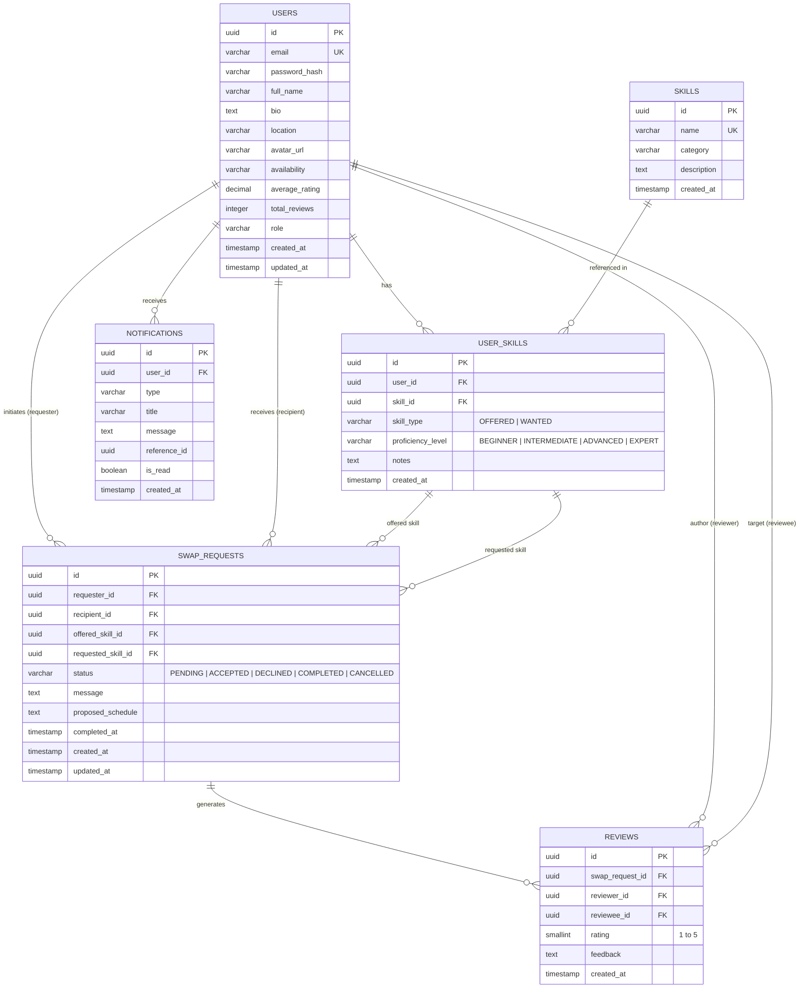

# Database Design Specification: Skill Swap Network

## 1. Relational Database Overview
The database engine is **PostgreSQL**, hosted on **Supabase** (free-tier). The schema enforces referential integrity through foreign keys, check constraints, unique constraints, and indexed lookups.

---

## 2. Entity-Relationship (ER) Model

---

## 3. Detailed Table Specifications

### 3.1 `users` Table
Stores registered member accounts, authentication credentials, profile information, and aggregated reputation statistics.

| Column | Type | Constraints | Description |
| :--- | :--- | :--- | :--- |
| `id` | `UUID` | `PRIMARY KEY, DEFAULT gen_random_uuid()` | Unique user identifier |
| `email` | `VARCHAR(255)` | `NOT NULL, UNIQUE` | User email address (login credential) |
| `password_hash` | `VARCHAR(255)` | `NOT NULL` | BCrypt encrypted password string |
| `full_name` | `VARCHAR(120)` | `NOT NULL` | Display name of the user |
| `bio` | `TEXT` | `NULL` | Personal bio and teaching/learning goals |
| `location` | `VARCHAR(100)` | `NULL` | City/Country or timezone |
| `avatar_url` | `VARCHAR(500)` | `NULL` | Profile picture link |
| `availability` | `VARCHAR(150)` | `NULL` | Preferred availability (e.g., "Weekends, Evenings") |
| `average_rating`| `NUMERIC(3,2)` | `DEFAULT 0.00` | Recalculated average rating (0.00 - 5.00) |
| `total_reviews` | `INTEGER` | `DEFAULT 0` | Count of verified swap reviews received |
| `role` | `VARCHAR(20)` | `NOT NULL, DEFAULT 'ROLE_USER'` | User authority (`ROLE_USER`, `ROLE_ADMIN`) |
| `created_at` | `TIMESTAMPTZ` | `NOT NULL, DEFAULT NOW()` | Record creation timestamp |
| `updated_at` | `TIMESTAMPTZ` | `NOT NULL, DEFAULT NOW()` | Last modification timestamp |

### 3.2 `skills` Table
Standardized master repository of skills and categories.

| Column | Type | Constraints | Description |
| :--- | :--- | :--- | :--- |
| `id` | `UUID` | `PRIMARY KEY, DEFAULT gen_random_uuid()` | Unique skill identifier |
| `name` | `VARCHAR(100)` | `NOT NULL, UNIQUE` | Skill title (e.g., "Python", "Spanish") |
| `category` | `VARCHAR(100)` | `NOT NULL` | Category (e.g., "Programming", "Languages") |
| `description` | `TEXT` | `NULL` | General description of the skill |
| `created_at` | `TIMESTAMPTZ` | `NOT NULL, DEFAULT NOW()` | Creation timestamp |

### 3.3 `user_skills` Table
Associates users with the skills they offer to teach (`OFFERED`) or desire to learn (`WANTED`).

| Column | Type | Constraints | Description |
| :--- | :--- | :--- | :--- |
| `id` | `UUID` | `PRIMARY KEY, DEFAULT gen_random_uuid()` | Association ID |
| `user_id` | `UUID` | `NOT NULL, FK -> users(id) ON DELETE CASCADE` | Associated user |
| `skill_id` | `UUID` | `NOT NULL, FK -> skills(id) ON DELETE RESTRICT` | Associated skill |
| `skill_type` | `VARCHAR(20)` | `NOT NULL, CHECK (skill_type IN ('OFFERED', 'WANTED'))` | Exchange orientation |
| `proficiency_level` | `VARCHAR(20)` | `NOT NULL, CHECK (proficiency_level IN ('BEGINNER', 'INTERMEDIATE', 'ADVANCED', 'EXPERT'))` | Proficiency |
| `notes` | `TEXT` | `NULL` | Specific experience or learning topics |
| `created_at` | `TIMESTAMPTZ` | `NOT NULL, DEFAULT NOW()` | Creation timestamp |

*Constraint:* Unique combination of `(user_id, skill_id, skill_type)` prevents duplicate entries.

### 3.4 `swap_requests` Table
Core transactional entity representing peer-to-peer swap proposals and their lifecycle.

| Column | Type | Constraints | Description |
| :--- | :--- | :--- | :--- |
| `id` | `UUID` | `PRIMARY KEY, DEFAULT gen_random_uuid()` | Unique swap request ID |
| `requester_id` | `UUID` | `NOT NULL, FK -> users(id) ON DELETE CASCADE` | User proposing the exchange |
| `recipient_id` | `UUID` | `NOT NULL, FK -> users(id) ON DELETE CASCADE` | Target partner |
| `offered_skill_id` | `UUID` | `NOT NULL, FK -> user_skills(id) ON DELETE RESTRICT` | Skill offered by requester |
| `requested_skill_id` | `UUID` | `NOT NULL, FK -> user_skills(id) ON DELETE RESTRICT` | Skill sought from recipient |
| `status` | `VARCHAR(20)` | `NOT NULL, DEFAULT 'PENDING'` | `PENDING`, `ACCEPTED`, `DECLINED`, `COMPLETED`, `CANCELLED` |
| `message` | `TEXT` | `NULL` | Initial proposal message |
| `proposed_schedule` | `TEXT` | `NULL` | Proposed meeting frequency/times |
| `completed_at` | `TIMESTAMPTZ` | `NULL` | When the swap was marked completed |
| `created_at` | `TIMESTAMPTZ` | `NOT NULL, DEFAULT NOW()` | Request submission timestamp |
| `updated_at` | `TIMESTAMPTZ` | `NOT NULL, DEFAULT NOW()` | Last update timestamp |

### 3.5 `reviews` Table
Post-swap feedback and rating records submitted by swap participants.

| Column | Type | Constraints | Description |
| :--- | :--- | :--- | :--- |
| `id` | `UUID` | `PRIMARY KEY, DEFAULT gen_random_uuid()` | Unique review ID |
| `swap_request_id` | `UUID` | `NOT NULL, FK -> swap_requests(id) ON DELETE CASCADE` | Associated swap |
| `reviewer_id` | `UUID` | `NOT NULL, FK -> users(id) ON DELETE CASCADE` | User giving the review |
| `reviewee_id` | `UUID` | `NOT NULL, FK -> users(id) ON DELETE CASCADE` | User being reviewed |
| `rating` | `SMALLINT` | `NOT NULL, CHECK (rating >= 1 AND rating <= 5)` | Rating out of 5 stars |
| `feedback` | `TEXT` | `NOT NULL` | Qualitative feedback comment |
| `created_at` | `TIMESTAMPTZ` | `NOT NULL, DEFAULT NOW()` | Review submission timestamp |

*Constraint:* Unique combination of `(swap_request_id, reviewer_id)` guarantees one review per participant per swap.

### 3.6 `notifications` Table
Real-time / in-app notifications alerting users to swap updates.

| Column | Type | Constraints | Description |
| :--- | :--- | :--- | :--- |
| `id` | `UUID` | `PRIMARY KEY, DEFAULT gen_random_uuid()` | Unique notification ID |
| `user_id` | `UUID` | `NOT NULL, FK -> users(id) ON DELETE CASCADE` | Target recipient user |
| `type` | `VARCHAR(50)` | `NOT NULL` | E.g. `SWAP_REQUEST`, `SWAP_ACCEPTED`, `REVIEW_RECEIVED` |
| `title` | `VARCHAR(150)` | `NOT NULL` | Notification title |
| `message` | `TEXT` | `NOT NULL` | Detailed notification message |
| `reference_id` | `UUID` | `NULL` | ID of relevant swap request or review |
| `is_read` | `BOOLEAN` | `NOT NULL, DEFAULT FALSE` | Read status |
| `created_at` | `TIMESTAMPTZ` | `NOT NULL, DEFAULT NOW()` | Notification timestamp |

---

## 4. Key Indexes for Performance (NFR-01)
- `CREATE INDEX idx_user_skills_user ON user_skills(user_id);`
- `CREATE INDEX idx_user_skills_skill ON user_skills(skill_id, skill_type);`
- `CREATE INDEX idx_swap_requests_requester ON swap_requests(requester_id, status);`
- `CREATE INDEX idx_swap_requests_recipient ON swap_requests(recipient_id, status);`
- `CREATE INDEX idx_reviews_reviewee ON reviews(reviewee_id);`
- `CREATE INDEX idx_notifications_user_read ON notifications(user_id, is_read);`
