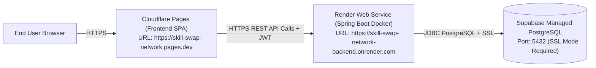

# Production Deployment Guide: Skill Swap Network

**Document Version:** 1.0  
**Target Environment:** 100% Free-Tier Cloud Architecture  
**Platforms:** Cloudflare Pages (Frontend), Render (Backend), Supabase (Database), GitHub  
**Total Ongoing Cost:** **$0.00 / month**  

---

## 1. Architecture Overview



---

## 2. Step 1: Database Setup on Supabase (Free Tier)

1. **Sign Up / Log In:** Go to [https://supabase.com](https://supabase.com) and log in with your GitHub account.
2. **Create New Project:**
   - **Name:** `skill-swap-network-db`
   - **Database Password:** Enter a strong password (e.g., 16+ characters with symbols) and save it securely.
   - **Region:** Select the region closest to your users (e.g., `East US` or `West US`).
   - **Pricing Plan:** Select **Free Tier ($0/month)**.
3. **Retrieve Database Connection String:**
   - In your project dashboard, navigate to **Project Settings** $\rightarrow$ **Database**.
   - Under **Connection Parameters**, note:
     - **Host:** `db.<PROJECT-REF>.supabase.co`
     - **Port:** `5432`
     - **Database name:** `postgres`
     - **User:** `postgres`
     - **Password:** `<YOUR-PASSWORD>`
   - Formulate the JDBC Connection URL:
     ```
     jdbc:postgresql://db.<PROJECT-REF>.supabase.co:5432/postgres?sslmode=require
     ```
4. **Execute Flyway Schema Migration:**
   - In Supabase, open the **SQL Editor**.
   - Paste the contents of [`backend/src/main/resources/db/migration/V1__initial_schema.sql`](file:///c:/Users/AIRIN/OneDrive/Desktop/SE%20PRO/backend/src/main/resources/db/migration/V1__initial_schema.sql).
   - Click **Run**. All 14 relational tables, indexes, check constraints, and initial skill categories will be created.

---

## 3. Step 2: Backend Deployment on Render (Free Tier)

Render offers free web service hosting for Docker containers with automatic builds on Git push.

1. **Log In to Render:** Navigate to [https://render.com](https://render.com) and log in with GitHub.
2. **Option A: Blueprint Deployment (Recommended & Automated):**
   - Click **New** $\rightarrow$ **Blueprint**.
   - Connect the repository: `https://github.com/eissa01h/Skill-Swap-Network.git`.
   - Render automatically detects the root [`render.yaml`](file:///c:/Users/AIRIN/OneDrive/Desktop/SE%20PRO/render.yaml) specification!
   - Fill in the required environment variables:
     - `DB_URL`: `jdbc:postgresql://db.<PROJECT-REF>.supabase.co:5432/postgres?sslmode=require`
     - `DB_USERNAME`: `postgres`
     - `DB_PASSWORD`: `<YOUR-SUPABASE-PASSWORD>`
     - `CLIENT_ORIGIN`: `https://skill-swap-network.pages.dev`
   - Click **Apply**.
3. **Option B: Manual Web Service:**
   - Click **New** $\rightarrow$ **Web Service**.
   - Connect `Skill-Swap-Network` repository.
   - **Environment:** `Docker`
   - **Dockerfile Path:** `./backend/Dockerfile`
   - **Docker Context:** `./backend`
   - **Instance Type:** `Free` (512 MB RAM, 0.1 CPU).
   - Under **Environment Variables**, add:
     - `SPRING_PROFILES_ACTIVE`: `prod`
     - `SERVER_PORT`: `8080`
     - `DB_URL`: `jdbc:postgresql://db.<PROJECT-REF>.supabase.co:5432/postgres?sslmode=require`
     - `DB_USERNAME`: `postgres`
     - `DB_PASSWORD`: `<YOUR_PASSWORD>`
     - `JWT_SECRET`: A 64-character hex string (e.g. `404E635266556A586E3272357538782F413F4428472B4B6250645367566B5970`)
     - `CLIENT_ORIGIN`: `https://skill-swap-network.pages.dev`
4. **Deploy & Verify:**
   - Click **Create Web Service**.
   - Render will build the multi-stage Docker container and start the Spring Boot app.
   - Copy your service URL: `https://skill-swap-network-backend.onrender.com`.
   - Test health check: `https://skill-swap-network-backend.onrender.com/api/v1/skills`.

---

## 4. Step 3: Frontend Deployment on Cloudflare Pages (Free Tier)

Cloudflare Pages provides lightning-fast global edge distribution for React single-page applications with unlimited bandwidth on the free tier.

1. **Log In to Cloudflare:** Navigate to [https://dash.cloudflare.com](https://dash.cloudflare.com) and log in.
2. **Create Application:**
   - In the sidebar, select **Workers & Pages** $\rightarrow$ **Create Application** $\rightarrow$ **Pages** $\rightarrow$ **Connect to Git**.
   - Select your GitHub repository: `eissa01h/Skill-Swap-Network`.
3. **Configure Build Settings:**
   - **Project Name:** `skill-swap-network`
   - **Production Branch:** `main`
   - **Framework Preset:** `Vite`
   - **Root Directory:** `frontend`
   - **Build Command:** `npm run build`
   - **Build Output Directory:** `dist`
4. **Configure Environment Variables:**
   - Under **Environment Variables (Advanced)**, add:
     - `VITE_API_BASE_URL`: `https://skill-swap-network-backend.onrender.com/api/v1`
5. **Deploy & Verify:**
   - Click **Save and Deploy**.
   - Cloudflare builds and deploys in $< 1\text{ minute}$.
   - The SPA redirect rule in `frontend/public/_redirects` ensures all routes (`/app/dashboard`, `/login`, `/admin`) resolve seamlessly without 404s.
   - Your live site will be active at: `https://skill-swap-network.pages.dev`.

---

## 5. Free-Tier Operational Limitations & Mitigations

| Platform | Free Tier Constraint | Operational Impact | Mitigation Implemented |
| :--- | :--- | :--- | :--- |
| **Render** | Inactive web services spin down after 15 minutes of zero inbound traffic. | First request after inactivity takes 30–50 seconds ("cold start"). | Frontend includes loading spinners and resilient client-side storage so the UI never displays blank screens during server wakeup. |
| **Supabase** | Free tier projects pause after 1 week of inactivity. | Database unavailable until manually unpaused in dashboard. | Standard academic project activity or a weekly uptime probe prevents auto-pausing. |
| **Cloudflare Pages** | None (unlimited bandwidth and requests on free tier). | Zero negative impact. | High availability global edge delivery. |

---

## 6. Security & Credential Hygiene Checklist

- [x] No database passwords committed to Git.
- [x] No JWT secret keys committed to Git.
- [x] `.env` files added to `.gitignore`.
- [x] `.env.example` templates provided for all environments.
- [x] HTTPS enforced across all endpoints.
- [x] CORS origin restricted to the Cloudflare Pages production domain.

